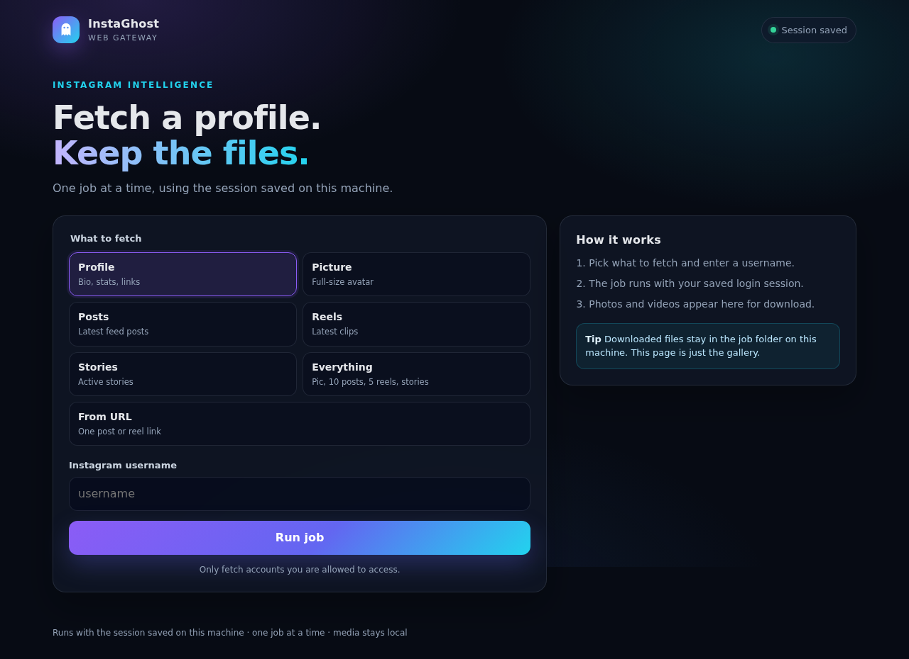

<p align="center">
  
</p>

<h1 align="center">InstaGhost</h1>

<p align="center">
  <strong>Instagram OSINT from your terminal.</strong><br>
  Profile intelligence, media downloads, and optional web and Telegram gateways,
  all on one reusable session.
</p>

<p align="center">
  <a href="LICENSE"></a>
  <a href="CHANGELOG.md"></a>
  <a href="https://python.org"></a>
</p>

> **Authorized use only.** InstaGhost is intended for accounts you own or have
> explicit permission to inspect. You are responsible for complying with
> Instagram's Terms of Service and applicable law.

---

## Table of contents

- [Overview](#overview)
- [Features](#features)
- [Requirements](#requirements)
- [Installation](#installation)
- [Quick start](#quick-start)
- [Authentication and sessions](#authentication-and-sessions)
- [Command-line reference](#command-line-reference)
- [Interactive mode](#interactive-mode)
- [Output and data locations](#output-and-data-locations)
- [Web gateway](#web-gateway)
- [Telegram bot](#telegram-bot)
- [Rate limits and troubleshooting](#rate-limits-and-troubleshooting)
- [Project structure](#project-structure)
- [Development](#development)
- [Security](#security)
- [Contributing](#contributing)
- [License](#license)
- [Disclaimer](#disclaimer)

---

## Overview

InstaGhost is a Python command-line tool for authorized Instagram profile
research. It uses the `instagrapi` private mobile API, saves the resulting
session, prints a structured profile report, and downloads profile pictures,
posts, reels, stories, and individual post or reel URLs.

The same saved session can power two optional, owner-only frontends:

- a local **web gateway** with a dark UI and download gallery;
- a **Telegram bot** for private, remote use.

Neither gateway accepts Instagram credentials. Both run jobs through the same
validated code path as the CLI and reuse the session created on the host.

InstaGhost is local-first: downloads stay on your machine unless you explicitly
send them through Telegram, and the web gateway binds to loopback by default.

---

## Features

| Capability | What it does |
| --- | --- |
| Profile report | Username, display name, user ID, bio, external URL, post/follower/following counts, private and verified flags, fetch timestamp. |
| Profile picture | Downloads the full-size avatar (`profile_pic_url_hd` when available). |
| Posts | Downloads the latest posts, including albums. |
| Reels | Downloads the latest clips through the dedicated clips API. |
| Stories | Downloads currently active stories, skipping individual items that fail. |
| Single URL | Fetches one post or reel from an Instagram URL. |
| Session reuse | Stores `instagrapi` settings and reuses them across CLI and gateway runs. |
| Login handling | Supports saved sessions, 2FA prompts, app-approval challenges, and clear rate-limit errors. |
| Cached profiles | Shows previously fetched profile data (marked as cached) when a live request is blocked. |
| Interactive mode | Numbered terminal menu for repeated operations. |
| Web gateway | Token link, HttpOnly cookie auth, job runner, gallery, and one job at a time. |
| Telegram bot | Numeric owner allowlist, long polling, direct media delivery, and temp-file cleanup. |
| Automation friendly | Sensible exit codes and no interactive prompts unless a job needs 2FA. |

---

## Requirements

- **Python 3.8 or newer**.
- **pip** for the pip installation paths, or **TermuxVoid** on Termux, plus
  network access.
- An **Instagram account** for authenticated requests. Instagram blocks most
  anonymous profile lookups, so logging in once is normally required.
- **Termux:** the TermuxVoid package is recommended because it installs every
  dependency automatically. Without TermuxVoid, install `python-pillow`
  (Pillow is required by `instagrapi`).
- Optional: `xdg-open`, `termux-open-url`, or `open` for automatically opening
  the web gateway in a browser.
- Write access to your home directory for sessions, cache, and downloads.

Runtime dependencies are declared in `pyproject.toml`:

```text
instagrapi>=2.0
requests>=2.25.1
```

---

## Installation

> On Termux with the TermuxVoid repository configured, the fastest path is
> `pkg install instaghost`. It installs every dependency and upgrades with the
> rest of your packages. See [TermuxVoid](#termuxvoid-recommended-on-termux).

### Standard installation

Install directly from GitHub:

```bash
python -m pip install "git+https://github.com/Anon4You/InstaGhost.git"
instaghost --version
```

Upgrade an existing install:

```bash
python -m pip install --upgrade "git+https://github.com/Anon4You/InstaGhost.git"
```

Use one install path per environment. If InstaGhost came from TermuxVoid,
upgrade it with `pkg upgrade`, not pip.

This registers three commands:

| Command | Purpose |
| --- | --- |
| `instaghost` | Main CLI |
| `instaghost-web` | Local web gateway |
| `instaghost-bot` | Telegram bot |

### TermuxVoid (recommended on Termux)

If the TermuxVoid repository is configured on your device, install InstaGhost
as a normal Termux package:

```bash
pkg update
pkg install instaghost
```

The package pulls in **all runtime dependencies automatically**, including
Python, `instagrapi`, Pillow, and `requests`. There is no pip step, no separate
Pillow install, and no TUR wheel setup.

TermuxVoid also handles upgrades. When a new InstaGhost release is published,
upgrade it together with the rest of your packages:

```bash
pkg upgrade
# or
apt upgrade
```

This keeps InstaGhost current without reinstalling it manually. The package
provides the same commands as the pip install: `instaghost`, `instaghost-web`,
and `instaghost-bot`.

Verify the install with:

```bash
instaghost --version
```

The `instaghost-web` command can open the gateway with `termux-open-url`; if no
opener is available, copy the printed URL manually.

### Termux without TermuxVoid

If TermuxVoid is not configured, use pip with Termux packages and the Termux
User Repository (TUR) wheel index for `instagrapi`:

```bash
pkg update
pkg install python python-pillow git
python -m pip install --upgrade pip setuptools wheel
python -m pip install --extra-index-url https://termux-user-repository.github.io/pypi/ instagrapi
python -m pip install "git+https://github.com/Anon4You/InstaGhost.git"
```

### From a source checkout

Use an editable install for development:

```bash
git clone https://github.com/Anon4You/InstaGhost.git
cd InstaGhost
python -m venv .venv
. .venv/bin/activate
python -m pip install -e .
```

Verify the install and run the test suite:

```bash
instaghost --version
python -m unittest discover -s tests -v
```

---

## Quick start

Log in once. The session is saved and reused by every later command:

```bash
instaghost --login --login-user YOUR_USERNAME --login-pass YOUR_PASSWORD
```

Then run the operation you need:

```bash
# Profile report only
instaghost TARGET_USERNAME

# Profile picture
instaghost TARGET_USERNAME -p

# Latest 10 posts
instaghost TARGET_USERNAME -P 10

# Latest 5 reels
instaghost TARGET_USERNAME -r 5

# Active stories
instaghost TARGET_USERNAME -s

# Profile picture + 10 posts + 5 reels + stories
instaghost TARGET_USERNAME -a

# One post or reel
instaghost --url https://www.instagram.com/p/SHORTCODE/

# Interactive menu after the profile report
instaghost TARGET_USERNAME -i
```

> `--save-login` is optional. Without it, only the session file is stored.
> With it, the password is written to `~/.config/instaghost/logindata` as
> plaintext JSON with mode `0600`. See [SECURITY.md](SECURITY.md).

---

## Authentication and sessions

Instagram requires authenticated requests for most lookups. InstaGhost logs in
with `instagrapi`, writes the resulting session, and automatically attaches that
session on every later CLI or gateway run.

### Session behavior

| Command | Behavior |
| --- | --- |
| `instaghost --login --login-user U --login-pass P` | Logs in and saves a session. Does not store the password unless `--save-login` is also used. |
| `instaghost --login --login-user U --login-pass P --save-login` | Logs in, saves the session, and writes credentials to `logindata`. |
| `instaghost --login` | Uses saved credentials when present; otherwise reports that a username and password are required. |
| `instaghost --login --login-user U` | Resumes the saved session for `U`; errors if no session exists. |
| `instaghost TARGET` | Automatically reuses any saved session before looking up the target. |

Session files live at:

```text
~/.config/instaghost/session-<username>
~/.config/instaghost/logindata            # only with --save-login
```

### 2FA and challenges

- If Instagram asks for a two-factor code, InstaGhost prompts for it in the
  terminal and retries the login.
- If Instagram returns a challenge, approve the login in the Instagram app and
  run the command again.
- Repeated failed logins can worsen rate limits. Wait before retrying.

### Private accounts

`--private` requires a valid saved session and access to the target:

```bash
instaghost private_account --private
```

If the account is private and the logged-in user does not follow it, Instagram
returns a private-account error. InstaGhost reports that clearly instead of
retrying.

### Cached profile data

Successful profile lookups are cached at
`~/.config/instaghost/profile-<username>.json`. If a later live request is
rate-limited, requires login, or fails, the CLI can print the cached report with
a warning. Downloads are not cached and always need a live request.

### Logging out

Remove the session file to force a fresh login:

```bash
rm ~/.config/instaghost/session-<username>
rm ~/.config/instaghost/logindata   # if you used --save-login
```

---

## Command-line reference

```text
instaghost <username> [options]
instaghost --url <instagram_url>
instaghost --login
```

| Option | Argument | Description |
| --- | --- | --- |
| `<username>` | Username | Target profile. Accepts letters, digits, dots, and underscores (1–30 characters). |
| `-i, --interactive` | — | Open the interactive menu after printing the profile report. |
| `-p, --profile-pic` | — | Download the full-size profile picture. |
| `-P, --posts` | Count | Number of latest posts to download. Required. |
| `-r, --reels` | Count | Number of latest reels to download. Required. |
| `-s, --stories` | — | Download active stories. |
| `-a, --all` | — | Download the profile picture, 10 posts, 5 reels, and stories. |
| `-o, --output` | Directory | Output directory. Default: `downloads`. |
| `-l, --login` | — | Run the login flow before the requested operation. |
| `--login-user` | Username | Instagram username for login. |
| `--login-pass` | Password | Instagram password for login. |
| `--save-login` | — | Save credentials to `logindata` after a successful login. |
| `--url` | URL | Download a post, reel, or TV item from an Instagram URL. |
| `--private` | — | Access a private account using the saved session. |
| `-h, --help` | — | Print the command reference and exit. |
| `-V, --version` | — | Print the version and exit. |

### Supported URL formats

`--url` accepts the common Instagram post, reel, and TV URL shapes:

```text
https://www.instagram.com/p/SHORTCODE/
https://www.instagram.com/reel/SHORTCODE/
https://www.instagram.com/reels/SHORTCODE/
https://www.instagram.com/tv/SHORTCODE/
```

Story URLs are not supported by `--url`; use `-s` to download active stories.

### Examples

```bash
# Report only
instaghost someuser

# Download 20 posts into an archive directory
instaghost someuser -P 20 -o archive

# Download everything using the saved session
instaghost someuser -a

# Refresh the saved session, then fetch a profile
instaghost --login --login-user YOUR_USERNAME --login-pass YOUR_PASSWORD
instaghost someuser -p

# Access a private account you are allowed to view
instaghost someuser --private

# Download a single reel
instaghost --url https://www.instagram.com/reel/SHORTCODE/
```

### Exit status

| Code | Meaning |
| --- | --- |
| `0` | Command completed successfully, or help/version was printed. |
| `1` | Login, lookup, validation, or one or more downloads failed. |
| `2` | Invalid command-line arguments (usage error). |
| `130` | Interrupted with `Ctrl-C`. |

When several download actions run (`-p -P -r -s` or `-a`), InstaGhost continues
after an individual download failure and reports the overall result at the end.

> Passing a password with `--login-pass` can expose it to shell history and the
> process list. Prefer a trusted terminal and session reuse, and clear shell
> history if necessary.

---

## Interactive mode

Start it with a target username:

```bash
instaghost someuser -i
```

The profile report is printed first, then the menu:

| Choice | Operation |
| --- | --- |
| `1` | Download profile picture |
| `2` | Download posts (prompts for a count; default 10) |
| `3` | Download reels (prompts for a count; default 5) |
| `4` | Download stories |
| `5` | Download everything |
| `6` | Show profile intelligence again |
| `7` | Download from a URL |
| `8` | Login operations |
| `0` | Exit |

Login operations include credential login, saved-data login, saving the current
login, clearing saved credentials, and checking login status.

---

## Output and data locations

### Downloads

Default output structure:

```text
downloads/
├── <username>_profile_pic.jpg
└── <username>/
    ├── posts/
    ├── reels/
    └── stories/
```

Use `-o DIR` to change the root. URL downloads are written directly into the
output directory rather than a per-user subdirectory. File names are generated
by `instagrapi`.

### Application data

| Data | Location | Notes |
| --- | --- | --- |
| Session settings | `~/.config/instaghost/session-<user>` | Grants account access. Do not share. |
| Saved credentials | `~/.config/instaghost/logindata` | Only with `--save-login`; plaintext JSON, mode `0600`. |
| Cached profile info | `~/.config/instaghost/profile-<user>.json` | Non-sensitive lookup cache. |
| Web gateway jobs | `~/.cache/instaghost-gateway/job-*` | Retained until you delete them. |
| Telegram bot jobs | Temporary `job-*` folders | Deleted after the bot sends files. |

See [SECURITY.md](SECURITY.md) for credential handling and reporting guidance.

---

## Web gateway

The web gateway is an optional local frontend over the saved session. Log in on
the host first:

```bash
instaghost --login --login-user YOUR_USERNAME --login-pass YOUR_PASSWORD
instaghost-web
```

Default behavior:

1. Listens on `127.0.0.1:8080`.
2. Generates a per-run token and prints a one-click URL:
   `http://127.0.0.1:8080/?token=...`
3. Opens the URL with `xdg-open`, `termux-open-url`, or `open` when available.
4. Stores the token in an HttpOnly, SameSite=Lax cookie on first visit and
   redirects to the clean page.
5. Runs one job at a time and shows the results in a gallery.

<p align="center">
  
</p>

### Options

| Option | Default | Description |
| --- | --- | --- |
| `--host` | `127.0.0.1` | Bind address. |
| `--port` | `8080` | Listen port. |
| `INSTAGHOST_WEB_TOKEN` | Random per run | Fixed token for a stable URL. Treat it as a password. |

### Available actions

| Action | Result |
| --- | --- |
| Profile | Profile report and job log; no files. |
| Picture | Full-size profile picture. |
| Posts | Latest posts (1–30; form default 5). |
| Reels | Latest reels (1–30; form default 5). |
| Stories | Active stories. |
| Everything | Picture + 10 posts + 5 reels + stories. |
| From URL | One post or reel link. |

### Security and operation

- The printed URL is a bearer credential. Anyone who has it can use the saved
  session. Do not paste it into chats, screenshots, or issue reports.
- The gateway speaks plain HTTP and is loopback-only by default. Do not expose
  it directly to untrusted networks. For remote use, place it behind a trusted
  HTTPS reverse proxy or tunnel.
- It never asks for an Instagram password.
- Web jobs stay under `~/.cache/instaghost-gateway/` until you remove them.
- Stop the server with `Ctrl-C`.

---

## Telegram bot

The Telegram gateway polls for commands and sends downloaded media back through
Telegram. Owner allowlisting is mandatory.

### Setup

1. Create a bot with Telegram's BotFather and copy its token.
2. Find your numeric Telegram user ID (for example, from a bot that reports IDs).
3. Export both values in the environment that runs the bot:

```bash
export TELEGRAM_BOT_TOKEN="123456789:ABCdef..."
export TELEGRAM_ALLOWED_USER_ID="123456789"
instaghost-bot
```

Multiple allowed IDs are supported, separated by commas or spaces:

```bash
export TELEGRAM_ALLOWED_USER_ID="123456789,987654321"
```

The bot exits at startup with a clear message if either variable is missing or
if an allowed ID is not numeric.

### Commands

| Command | Action |
| --- | --- |
| `/profile <user>` | Profile report |
| `/pic <user>` | Profile picture |
| `/posts <user> [n]` | Latest posts (default 5, max 30) |
| `/reels <user> [n]` | Latest reels (default 5, max 30) |
| `/stories <user>` | Active stories |
| `/all <user>` | Picture + 10 posts + 5 reels + stories |
| `/url <instagram_url>` | One post or reel link |
| `/help`, `/start` | Command list |

### Limits and behavior

- Only IDs in `TELEGRAM_ALLOWED_USER_ID` are accepted; every other user gets
  `Not allowed`.
- Long polling is used; no webhook or public port is required.
- Files over Telegram's 50 MB bot limit are skipped with a message.
- Photos up to 10 MB use `sendPhoto`; larger photos and other files use
  `sendDocument`. MP4 files use `sendVideo` with a document fallback.
- Temporary job folders are deleted after the bot sends the results.
- Media delivered through Telegram leaves your machine and is handled by
  Telegram's servers.

See [SECURITY.md](SECURITY.md) for token handling.

---

## Rate limits and troubleshooting

Instagram throttles aggressive automation. `instagrapi` uses the private mobile
API and is more robust than web scraping, but limits still apply. If requests
start failing:

1. Stop all InstaGhost instances and close the Instagram app.
2. Do not rotate VPNs or IP addresses between retries.
3. Wait 30–60 minutes, then log in once and make a single request.
4. Approve any challenge in the Instagram app, then retry.
5. Reduce counts for posts, reels, and `/all` jobs.

InstaGhost reuses saved sessions specifically to avoid repeated logins, which
are themselves heavily rate-limited. Cached profile info is shown when a live
lookup is blocked, but downloads always need a live request.

| Symptom | Likely cause | Action |
| --- | --- | --- |
| `Rate-limited` / `429 Too Many Requests` | Instagram throttling | Wait, then retry once. Avoid parallel runs. |
| `Login required` | No valid session | Log in with `instaghost --login --login-user USER --login-pass PASS`, then retry. |
| `Challenge required` | Instagram wants app approval | Approve the login in the Instagram app, then retry. |
| `Target not found` | Wrong username or deleted account | Check the exact username. |
| Private account error | Not logged in, or not following | Log in with an account that can view the target, or use `--private`. |
| Web page says "No saved session" | No login on the host | Log in on the host before starting the gateway. |
| Web link lost | Server restarted with a new token | Restart and use the new link, or set `INSTAGHOST_WEB_TOKEN`. |
| Bot does not respond | Missing env vars, wrong owner ID, or polling error | Check startup output, env vars, and the numeric user ID. |
| `Nothing was downloaded` | Private target, deleted media, or API failure | Read the job log for the specific Instagram error. |
| Termux install fails on Pillow | Missing system Pillow package or wheel | Install through TermuxVoid (`pkg install instaghost`), or run `pkg install python-pillow` and use the TUR index as shown above. |

---

## Project structure

```text
src/instaghost/
├── __init__.py       package version and metadata
├── __main__.py       `python -m instaghost` entry
├── cli.py            argument parsing and CLI flow
├── client.py         Instagram session, lookups, and downloads
├── auth.py           saved credentials and session file helpers
├── cache.py          cached profile info
├── config.py         filesystem paths and defaults
├── errors.py         grouped instagrapi exceptions
├── output.py         terminal styling, status lines, spinner
├── gateway.py        shared job runner and validation for gateways
├── web.py            web gateway HTTP server and rendering
├── webui/            HTML templates, CSS, JS, favicon
└── telegram_bot.py   Telegram long-polling bot
tests/
├── test_gateway.py   validation and command parsing
└── test_web.py       authentication, escaping, and UI files
docs/                 README assets
pyproject.toml        packaging, entry points, and package data
SECURITY.md           credential and vulnerability guidance
CHANGELOG.md          release history
```

The web UI is plain HTML, CSS, and JavaScript; there is no build step. Templates
and assets are included in wheels through `[tool.setuptools.package-data]`.

---

## Development

```bash
git clone https://github.com/Anon4You/InstaGhost.git
cd InstaGhost
python -m venv .venv
. .venv/bin/activate
python -m pip install -e .

# Unit tests (stdlib unittest; no Instagram login or network needed)
python -m unittest discover -s tests -v

# Syntax check
python -m py_compile src/instaghost/*.py
```

Useful entry points during development:

```bash
instaghost --help
instaghost-web --help
python -m instaghost --version
```

To verify that a distribution includes the web UI:

```bash
python -m pip wheel . --no-deps -w dist
python -m zipfile -l dist/instaghost-*.whl | grep webui
```

---

## Security

- Session files and login credentials grant account access. Keep them private.
- The web token and Telegram bot token are bearer credentials.
- Gateways never accept Instagram passwords over the network.
- Only expose the web gateway on networks you trust, preferably through HTTPS.
- Review [SECURITY.md](SECURITY.md) before deploying either gateway or using
  `--save-login`.

---

## Contributing

1. Fork the repository and create a focused branch.
2. Keep changes modular and add or update tests under `tests/`.
3. Run the test suite and syntax check before opening a pull request.
4. Update `CHANGELOG.md` for user-visible changes.
5. Never commit session files, credentials, tokens, downloaded media, or target
   account data.
6. Report bugs through the repository issue tracker with redacted output.

Please keep feature proposals within the project's authorized-use scope.

---

## License

This project is licensed under the MIT License. See [LICENSE](LICENSE) for the
full text.

---

## Disclaimer

InstaGhost is provided for educational and authorized security research. Use it
only on accounts you own or have explicit permission to access. The authors are
not responsible for misuse, account restrictions, data loss, or violations of
Instagram's Terms of Service or applicable law. You are solely responsible for
how you use this software.

<p align="center">
  <strong>Built with Python and instagrapi.</strong><br>
  See <a href="CHANGELOG.md">CHANGELOG.md</a> for release history and
  <a href="SECURITY.md">SECURITY.md</a> for security guidance.
</p>
